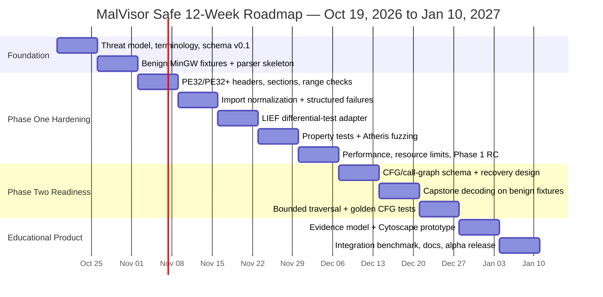

# MalVisor: Safe Architecture, Phase-One Hardening, and Research Roadmap

## Executive summary

MalVisor has a credible core idea: a **Linux-hosted, static-first Windows PE analysis platform that turns binary structure and evidence into an educational visual model**. The uploaded architecture already separates the analyzer, visualizer, and JSON exchange layer, and it explicitly frames the project around reverse-engineering education rather than offensive execution. fileciteturn0file0 That separation is the project's strongest architectural decision.

The design nevertheless needs several corrections before Codex should write serious code.

The most important one is semantic: **Phase One cannot truthfully “identify all Windows APIs that are called.”** A PE import table describes statically declared imports, including name- and ordinal-based imports; Microsoft also specifies separate delay-import structures. It does not prove that an imported function executes at runtime, nor does it capture every function a program may resolve by other mechanisms. The Phase One output should therefore say **“statically declared imports”**, never “API calls observed.” citeturn17search0

The second major correction is that **Phase Three's “malicious Windows API dictionary” is too simplistic to be a serious security detector**. Legitimate software and malicious software use the same Windows APIs. Mature capability-detection systems such as Mandiant/Google FLARE's capa use combinations of evidence, scopes, rules, and mappings to frameworks such as MITRE ATT&CK, and they expose the evidence that caused a rule to match. capa already has a browser-based explorer, so “API risk labels + interactive visualization” by itself is not enough novelty for MalVisor. citeturn21search0

The third correction concerns Phase Two: **Capstone is an instruction decoder, not a CFG recovery engine**. It can decode x86/x64 instructions and expose instruction details, but MalVisor must supply function discovery, address translation, block termination, traversal, edge classification, uncertainty handling, and resource limits. Capstone itself warns that code/data ambiguity makes naive disassembly unreliable. citeturn16search4turn16search16

The fourth is security-critical: **the proposed Phase Five should not be part of the initial MalVisor implementation at all**. Suspended-process memory dumping changes the project from a parser of adversarial data into a system that deliberately loads untrusted executables. That conflicts with the earlier “no active execution” trust model and creates a radically different operational, legal, platform, and containment problem. A much safer replacement is a **dynamic-report ingestion interface** that imports results produced elsewhere by established analysis environments. capa already supports reports from CAPE, DRAKVUF, and VMRay, demonstrating that static tooling can consume dynamic evidence without bundling a malware executor. citeturn21search0

My recommended architecture is therefore:

```text
                 MALVISOR TRUST BOUNDARY

     Untrusted PE bytes
            │
            ▼
  ┌─────────────────────┐
  │ isolated parser     │
  │ no network          │
  │ no execution        │
  │ resource bounded    │
  └─────────┬───────────┘
            │
            │ normalized evidence
            ▼
  ┌─────────────────────┐
  │ MalVisor JSON       │
  │ facts + warnings    │
  │ provenance          │
  │ uncertainty         │
  └─────────┬───────────┘
            │
       ┌────┴─────┐
       ▼          ▼
   Phase Two    Phase Three
   CFG engine   rule/evidence engine
       │          │
       └────┬─────┘
            ▼
  ┌─────────────────────┐
  │ educational UI      │
  │ Cytoscape.js        │
  │ evidence sidebar    │
  │ no binary execution │
  └─────────────────────┘

  Future optional input:
  pre-generated sandbox/capa report ───────► evidence layer

  NOT in initial product:
  malware execution / process dumping / unpacking executor
```

For the initial implementation, **Python + pefile as the primary Phase One backend, LIEF as a differential-testing oracle, JSON Schema Draft 2020-12, pytest/Hypothesis/Atheris for robustness testing, Capstone for Phase Two, and Cytoscape.js for the UI** gives the best balance between development speed, transparency, safety, and eventual migration to faster components. pefile is cross-platform, MIT-licensed, designed specifically for PE parsing, reports malformed/suspicious structures, and describes itself as robust from extensive production use while explicitly acknowledging that it is not perfect. LIEF provides a modern C++ core with Python/Rust interfaces and substantially broader executable-format support. citeturn16search0turn16search5turn16search13

The strongest path to genuine novelty is **not “build another malware scanner.”** MalVisor should become an **explainable binary-analysis tutor**: every conclusion should connect *raw PE fact → normalized evidence → inference/rule → confidence → educational explanation → ATT&CK/capa reference*, with explicit uncertainty. Research such as PRISM's 2026 section-aware PE representation and work on semantic PE malware ontologies suggests useful unexplored directions around structural relationships and interpretable representation rather than yet another binary malicious/benign score. citeturn22academia47turn22academia50

The practical priority is consequently:

**Weeks 1–7:** make Phase One boringly reliable.  
**Weeks 8–10:** build a deliberately partial, uncertainty-aware Phase Two.  
**Weeks 11–12:** integrate educational visualization and evidence provenance.  
**Phase Five:** defer indefinitely unless it becomes a separately governed research project.

That is less cinematic than firing up unknown malware from your shiny new GitHub project. It is also how you avoid turning “educational PE viewer” into “surprise incident-response exercise.”

## Architecture assessment

The current MalVisor concept defines a backend PE analyzer, a frontend graph visualizer, and a JSON protocol between them, with later ideas including entropy-based packing indicators, Volume Shadow Copy access, and suspended-process memory dumping. fileciteturn0file0 The layered design is sound, but the trust boundaries and semantics need to become much stricter.

| Phase | Main strengths | Main weaknesses and risks | Recommended disposition |
|---|---|---|---|
| **Phase One — PE parsing** | Static-only; naturally cross-platform; useful independently of malware detection; easy to test with deterministic fixtures | “All APIs called” is technically incorrect; malformed PE files are adversarial parser input; raw RVA/file-offset conversions are easy to get wrong; unbounded imports/strings/sections can produce denial-of-service behavior | **Build first and harden aggressively** |
| **Phase Two — disassembly/CFG** | High educational value; turns bytes into execution structure; natural bridge to API evidence | Capstone does not recover CFGs automatically; linear sweep confuses data and code; recursive traversal misses unknown/indirect targets; “CALL/JMP graph” conflates CFG and call graph; graphs can explode in size | **Build only after Phase One contract is stable** |
| **Phase Three — educational heuristics** | Excellent educational opportunity; can convert low-level evidence into understandable capabilities | API blacklists cause false positives; “threat level” implies more certainty than evidence supports; strong overlap with existing capa functionality | **Redesign as evidence-based findings, not an API blacklist** |
| **Phase Four — visualization** | Makes reverse engineering approachable; Cytoscape is a strong fit; local/offline UI is feasible | Large CFGs become visual spaghetti; red/yellow/green implies binary certainty; uploaded JSON is itself untrusted input; Electron unnecessarily enlarges the attack surface for MVP | **Browser-first local viewer; Electron later if justified** |
| **Phase Five — dynamic dumping** | Could eventually improve visibility into packed/obfuscated programs | Loads untrusted executables; conflicts with static-analysis trust model; Windows-specific; substantially higher operational/legal burden; difficult to make reliable; dangerous feature creep | **Defer and replace initially with report ingestion** |

**Phase One is stronger than it first appears.** PE parsing itself is a substantial engineering surface. Microsoft's PE/COFF specification covers headers, sections, data directories, imports, exports, relocations, debugging structures, certificates, delay imports, and architecture-specific differences; Microsoft explicitly notes that the document is intended to help tool developers but is not guaranteed to be a complete specification in all respects. This is exactly why a “quick custom parser” often starts adorable and ends as a small archaeology expedition. citeturn17search0

The biggest Phase One semantic problem is the original task description. The Import Lookup Table contains 32-bit entries in PE32 and 64-bit entries in PE32+, with imports represented by names or ordinals, while the IAT is part of the import-resolution machinery. Microsoft separately defines delayed imports. **Inference:** this data supports a report of what a file declares/imports statically; it does not constitute runtime observation. MalVisor should explicitly preserve that distinction in its terminology and UI. citeturn17search0

Phase Two should also distinguish three separate concepts that the current prompt blends together:

| Concept | What MalVisor should represent |
|---|---|
| **Instruction stream** | Decoded instructions at particular RVAs |
| **Intraprocedural CFG** | Basic blocks with branch/fall-through edges inside a recovered function |
| **Call graph** | Caller → callee relationships between functions/import stubs/unknown destinations |

A `CALL` should generally create a **call relationship**, not merely an ordinary CFG branch; a conditional branch can produce both a taken edge and a fall-through edge; unconditional branches terminate blocks; returns terminate paths; and indirect branches may have unresolved destinations. Capstone provides the instruction-decoding substrate, but the recovery policy remains MalVisor's responsibility. Capstone's own documentation cautions that merely finding decodable bytes is not a reliable method for distinguishing code from embedded data. citeturn16search4turn16search16

Phase Three has the greatest product-design problem. The proposed mapping:

```text
VirtualAllocEx → dangerous
WriteProcessMemory → dangerous
CreateRemoteThread → dangerous
```

looks intuitive, but it confuses **primitive** with **behavior**. Security frameworks increasingly emphasize correlations and context: MITRE's detection guidance for persistence, for example, combines registry modification with execution context rather than treating one registry-related operation as proof of malicious persistence. capa similarly uses rules composed from APIs, constants, strings, subrules, scopes, and other evidence, then lets analysts inspect exactly where the match came from. citeturn21search13turn21search0

MalVisor should therefore never attach an intrinsic label such as:

```json
{
  "api": "VirtualAllocEx",
  "threat_level": "high"
}
```

Instead:

```json
{
  "api": "VirtualAllocEx",
  "classification": "security_relevant_primitive",
  "finding_refs": ["F-001"]
}
```

and a separate finding might say that **a combination of several independently observed static features** resembles a documented behavior, with confidence and evidence attached.

That design change simultaneously improves technical accuracy, educational value, and legal/ethical messaging. MalVisor explains evidence rather than declaring some random game launcher “malware” because Windows APIs dared to exist.

Phase Four is conceptually strong. Cytoscape.js is purpose-built for graph modeling and visualization, supports directed and compound graphs, JSON serialization, layouts, selectors, user interaction, and graph algorithms, and is MIT-licensed. citeturn18search1 But the design should not use red/yellow/green as the sole way to communicate significance; WCAG's color guidance specifically requires that color not be the only visual mechanism conveying information. Pair color with labels, icons, node shapes, confidence text, and accessible descriptions. citeturn14search5

The JSON viewer must also treat `edu_desc`, DLL names, import strings, filenames, and future rule descriptions as untrusted text. Rendering attacker-controlled strings with `innerHTML` creates an obvious DOM-injection problem; OWASP recommends using text-oriented DOM sinks such as `textContent` for untrusted display strings and sanitizing HTML only when HTML rendering is genuinely required. citeturn15search0

A browser-only viewer is therefore preferable before Electron. Should Electron eventually be used, its own security guidance recommends keeping Node integration disabled for untrusted content, enabling context isolation, and using process sandboxing. citeturn14search0

An appropriate UI would emphasize *evidence and uncertainty*, not just scary colors:

```text
┌──────────────────────────────────────────────────────────────────────────────┐
│ MalVisor  │ hello-x64.exe │ SHA-256 … │ STATIC ONLY │ status: PARTIAL      │
├────────────────┬─────────────────────────────────────┬───────────────────────┤
│ PE STRUCTURE   │ ANALYSIS GRAPH                      │ EVIDENCE / EDUCATION  │
│                │                                     │                       │
│ ▾ Headers      │       ┌──────────────┐              │ Finding: F-003        │
│   DOS          │       │ entry block  │              │ "Memory-management   │
│   COFF         │       │ RVA 0x14D0   │              │ API imported"        │
│   Optional     │       └──────┬───────┘              │                       │
│                │              │ fallthrough           │ Confidence: Low      │
│ ▾ Sections     │              ▼                       │ Evidence type:        │
│   .text        │       ┌──────────────┐               │ static import         │
│   .rdata       │       │ basic block  │──── call ──┐ │                       │
│   .data        │       └──────────────┘            │ │ Why it matters       │
│                │                                   ▼ │ This primitive can    │
│ ▾ Imports      │                          ┌──────────┐│ appear in benign and  │
│   KERNEL32.dll │                          │ API node ││ malicious software.   │
│   USER32.dll   │                          └──────────┘│ It is not a verdict.  │
│                │                                     │                       │
│ ▾ Warnings     │  [CFG] [Calls] [Imports] [Sections] │ Source / ATT&CK refs  │
├────────────────┴─────────────────────────────────────┴───────────────────────┤
│ ⚠ Static evidence describes file structure/capabilities, not runtime proof. │
└──────────────────────────────────────────────────────────────────────────────┘
```

Finally, Phase Five is the major security discontinuity. Loading a suspicious executable as a process—even with execution intentionally constrained—belongs to a different threat model from reading bytes. The core project should instead define a **dynamic evidence adapter** that consumes already-produced external reports. capa demonstrates this architecture by accepting CAPE, DRAKVUF, and VMRay output in addition to static binaries. citeturn21search0

## Mitigations and safer alternatives

The following matrix ties each material weakness to concrete engineering actions rather than the traditional cybersecurity strategy of adding the word “secure” to the README and hoping for moral support.

| Weakness | Concrete mitigation | Implementation approach | Tests | Trade-off |
|---|---|---|---|---|
| IAT described as “all called APIs” | Rename output to **static imports** | Preserve DLL, symbol/ordinal, hint, thunk/IAT RVA, import type | PE with used/unused imports, ordinal imports, no imports | Less dramatic wording; much more accurate |
| Malformed PE can crash/hang parser | Run parser in isolated worker with strict limits | Unprivileged user, no network, read-only input, execution timeout, memory limit, maximum object/string counts | Mutation corpus + fuzzing | Small IPC overhead |
| Custom PE parsing error-prone | Use pefile first; LIEF as independent comparator | Adapter interface hides backend | Differential corpus | Two dependencies in CI |
| Huge/unbounded metadata | Resource budgets | Limits on file size, section count, import descriptors, symbols, string length, emitted warnings | Boundary tests around every cap | Extremely exotic valid files may return `partial` |
| Ambiguous RVAs | One canonical RVA mapping function | Validate mapping against section raw/virtual ranges before every dereference | Property tests and hand-built PE fixtures | More code up front |
| CFG recovery uncertain | Preserve unknowns rather than guessing | `direct`, `conditional`, `fallthrough`, `call`, `return`, `indirect_unknown` edge types | Tiny known-control-flow programs | Graph appears less “complete,” but is honest |
| Linear sweep decodes data | Prefer bounded recursive traversal for MVP | Start at known root; only decode mapped executable regions | Embedded-data fixture | May miss unreachable functions |
| Recursive traversal misses indirect targets | Explicit unresolved targets | Never fabricate indirect destinations; add later recovery sources | Function-pointer fixture | Lower recall initially |
| `CALL/JMP` treated as one graph | Separate CFG from call graph | Distinct JSON arrays or edge domains | Golden graph comparisons | Slightly larger schema |
| API blacklist false positives | Evidence-based capability rules | Rule ID, evidence list, confidence, source, ATT&CK/capa mapping | Benign programs deliberately using “suspicious” APIs | More rule authoring effort |
| `threat_level` overstates certainty | Split **severity**, **confidence**, and **evidence strength** | Findings exist independently of nodes | Schema validation | More nuanced UI |
| Entropy ⇒ packed binary | Use indicators, not boolean verdict | Per-section entropy + structural anomalies → `packing_indicators[]` | Compressed benign resources and normal executables | No satisfying “PACKED: YES” badge |
| Huge graph unusable | Multi-resolution graph | function → basic block → instruction drill-down | Graph-size/load benchmarks | Additional frontend state |
| JSON can inject UI content | Validate schema and render as text | JSON Schema + `textContent`; prohibit arbitrary HTML | `<script>` in all string fields | Rich HTML descriptions require explicit sanitizer |
| Electron increases attack surface | Browser-first frontend | Local static SPA reads JSON via file picker | CSP/UI tests | No desktop shell initially |
| Malware sample provenance unclear | Intake and retention policy | record source/license/authorization/hash; no automatic upload | Metadata completeness tests | Slight analyst friction |
| Phase Five breaks trust model | Replace with report import | adapter for offline dynamic reports | benign canned reports | No integrated unpacking in early releases |
| VSS/locked-file scope creep | Remove from MVP | analyze explicit file bytes only | N/A | Less “forensic suite” branding, far clearer scope |

pefile is particularly appropriate for the first iteration because it is a self-contained Python PE parser that runs on Linux, exposes headers and sections, provides warnings for malformed/suspicious values, and says it has been hardened through large-scale real-world use while remaining imperfect. That final caveat matters: a library being robust does **not** justify parsing arbitrary adversarial files in an unrestricted long-running server process. citeturn16search0turn16search2

LIEF is a compelling second implementation because it exposes PE parsing through C++, Python, and Rust and also handles other executable formats. Rather than choosing between pefile and LIEF by vibes, MalVisor can exploit their independence: normalize both parsers into the same internal representation during CI and identify disagreements. That turns a dependency decision into a research and robustness feature. citeturn16search5turn16search13

For Phase Two, begin with **one deliberately bounded analysis mode**:

```text
PE entry point
     │
     ▼
validate executable mapping
     │
     ▼
decode basic block
     │
     ├── ordinary instruction ── continue
     │
     ├── conditional branch ──── taken + fallthrough
     │
     ├── direct jump ─────────── target
     │
     ├── direct call ─────────── call edge + fallthrough
     │
     ├── indirect control ────── unresolved edge
     │
     └── return/invalid/budget ─ stop
```

Do **not** initially claim to recover every function. A graph with explicit “unknown target” edges is scientifically better than a beautiful hallucination made of hex addresses.

For Phase Three, a useful finding model is:

```json
{
  "id": "F-001",
  "title": "Process-manipulation primitives present",
  "category": "capability_indicator",
  "severity": "informational",
  "confidence": 0.72,
  "evidence": [
    {
      "type": "static_import",
      "ref": "import:KERNEL32.dll:ExampleFunction"
    }
  ],
  "framework_refs": [],
  "limitations": [
    "Static imports do not demonstrate runtime execution.",
    "The primitive may have legitimate uses."
  ]
}
```

That structure is philosophically much closer to capa's evidence-oriented model than a red skull pasted on an API node. capa is especially relevant because it already exposes verbose evidence, ATT&CK/MBC mappings, rules, and a web explorer, while warning that static results may be incomplete or misleading on packed/obfuscated binaries. citeturn21search0

**Legal and ethical mitigation should be engineered, not relegated to a disclaimer.** MalVisor should store only the metadata needed for reproducibility by default, never automatically transmit samples to cloud services, avoid shipping third-party malware binaries in the Git repository, and document that users are responsible for authorization and sample/dataset licensing in their jurisdiction. Dataset terms must be checked independently; SOREL-20M, for example, publishes specific terms of use rather than simply declaring unrestricted binary redistribution. citeturn22search0turn22search11

Dependency licensing also deserves an actual `THIRD_PARTY_NOTICES.md` and SPDX-style inventory. The candidate libraries span MIT for pefile and Cytoscape.js, Apache-2.0 for LIEF and capa, BSD for Capstone, ISC for D3, EPL-2.0 for current Graphviz releases, LGPLv3 for most radare2, and a GPLv2/commercial dual-license arrangement for Keystone. citeturn16search0turn16search5turn16search4turn18search1turn20search0turn20search1turn18search5turn19search0

That licensing mix does **not** mean the project is impossible to distribute. It means “we'll figure licensing out five minutes before v1.0” would be, scientifically speaking, a clown maneuver.

## Tooling comparison

The following performance ratings are **qualitative engineering expectations, not measured MalVisor benchmarks**. Actual latency, memory usage, and corpus coverage should be benchmarked before the backend is frozen.

**PE parsing alternatives**

| Tool | Language/API | Maturity | License | Expected performance | PE parsing completeness | Integration ease | Recommended MalVisor use |
|---|---|---:|---|---|---|---|---|
| **pefile** citeturn16search0 | Python | High | MIT | Moderate | High for PE inspection; focused specifically on PE | **Excellent** | **Primary Phase One MVP parser** |
| **LIEF** citeturn16search5turn16search13 | C++ core; Python/Rust APIs | High | Apache-2.0 | High | High; broad PE object model plus multiple executable formats | Very good | Differential oracle now; potential long-term backend |
| **Custom C parser** | C | New/project-specific | Project-chosen | Potentially very high | Initially low; only what MalVisor implements | Difficult | Research/fuzzing project only, not MVP |

pefile's biggest advantage is iteration speed and transparency. It is self-contained, cross-platform, and already handles malformed inputs and numerous PE features. Its weakness is precisely that Phase One then depends on a relatively large parser implementation that MalVisor does not control. citeturn16search0

LIEF offers stronger long-term architectural leverage because it can parse and manipulate PE, ELF, Mach-O and related formats through consistent APIs, but MalVisor currently gains little from multi-format support. Supporting twelve binary formats before making one reliable would be a fantastic way to develop twelve mediocre analyzers at once. citeturn16search5

A custom C parser should therefore be a future research branch, perhaps benchmarked against pefile/LIEF under fuzzing. It should not block the educational product.

**Disassembly and analysis alternatives**

| Tool | Language/API | Maturity | License | Expected performance | Analysis completeness | Integration ease | Recommended MalVisor use |
|---|---|---:|---|---|---|---|---|
| **Capstone** citeturn16search4 | C core; many bindings including Python | High | BSD | High | Excellent instruction decoding; **not a full CFG/function analyzer** | **Excellent** | **Default Phase Two instruction decoder** |
| **Keystone** citeturn19search0 | C/C++ + bindings | Mature but specialized | GPLv2 + licensing exceptions/commercial option | High at assembly | **N/A — assembler, not disassembler** | Moderate | Generate controlled instruction fixtures only |
| **radare2** citeturn18search0turn18search5 | C; scripting/r2pipe | High | Mostly LGPLv3; plugin licenses vary | High but heavier | Broad parsing, analysis, disassembly, debugging ecosystem | Moderate | Optional oracle / advanced analysis backend |

The comparison exposes an important flaw in the original tool shortlist: **Keystone is not an alternative to Capstone for Phase Two.** Keystone assembles textual instructions into machine code; Capstone disassembles bytes into instructions. Keystone can be useful in testing, but placing it in the runtime disassembly pipeline would be the binary-analysis equivalent of bringing a toaster to perform refrigerator duties. citeturn19search0turn16search4

radare2 is interesting as a Phase Two oracle because it is a complete reversing framework with PE/PE+ support, disassembly, analysis, scripting, and many architectures. It is much heavier than Capstone, however, and its plugin/dependency licensing requires more attention. citeturn18search0turn18search5

**Visualization alternatives**

| Tool | Language/API | Maturity | License | Expected performance | Graph completeness/flexibility | Integration ease | Recommended MalVisor use |
|---|---|---:|---|---|---|---|---|
| **Cytoscape.js** citeturn18search1 | JavaScript | High | MIT | High for interactive network visualization | Rich graph model, layouts, filtering, events, JSON | **Excellent** | **Primary interactive UI** |
| **D3** citeturn20search0 | JavaScript | Very high | ISC | High, highly implementation-dependent | Extremely flexible but low-level | Moderate–difficult | Bespoke educational diagrams/charts |
| **Graphviz** citeturn20search14turn20search1 | Native tools/library + bindings | Very high | EPL-2.0 for current versions | Strong offline layout | Excellent directed/hierarchical layout; weaker direct interaction | Easy–moderate | Static SVG export and optional layout engine |

Cytoscape.js is the clear default. It already models directed graphs, supports JSON serialization and rich interaction, and avoids MalVisor spending six months reinventing zoom, pan, selection, and graph filtering. citeturn18search1

D3 should be reserved for genuinely custom educational visualizations such as PE memory maps, section entropy charts, or import distributions. Its official description emphasizes a lower-level, web-standards-based approach that trades convenience for flexibility. citeturn20search0

Graphviz is especially useful for reproducible static output. Its `dot` engine is explicitly designed for hierarchical/layered directed graphs, making it appropriate for exported call graphs and small CFGs. Current Graphviz releases moved to EPL-2.0 in March 2026, which should be captured in MalVisor's dependency notices. citeturn20search13turn20search1

My recommended combination is therefore:

```text
                    ┌──────── pefile ──────── primary Phase 1
PE bytes ───────────┤
                    └──────── LIEF ────────── differential test oracle

PE normalized model ───────── Capstone ────── bounded Phase 2 decoding

MalVisor JSON ──────┬──────── Cytoscape.js ─ interactive application
                    ├──────── Graphviz ────── SVG/static export
                    └──────── D3 ──────────── optional non-graph charts
```

## Phase One hardened contract

Phase One should be treated as a **hostile-input parser project**, not as the boring prerequisite before the “real reverse engineering stuff.”

Microsoft distinguishes an RVA from a file position, and the relationship between them depends on section mapping; that alone makes range validation fundamental. Every offset, size, RVA, section boundary, directory entry, string pointer, import thunk, and table count must be treated as untrusted arithmetic. citeturn17search0

The recommended public parser interface is intentionally tiny:

```python
parse_pe_bytes(data: bytes, options: ParseOptions) -> AnalysisReport
```

It should have **no API for execution, shell invocation, Wine, process creation, DLL loading, or arbitrary sample writes**.

A separate CLI may handle file I/O:

```text
malvisor analyze sample.exe --output report.json
```

but the core parser should receive bytes and return a model. That architecture makes unit testing, fuzzing, isolation, and future server integration considerably simpler.

**Suggested processing contract**

```text
read bytes
   │
   ├── SHA-256 + size
   │
   ├── preliminary magic/bounds checks
   │
   ├── parse PE structures using backend
   │
   ├── normalize into MalVisor model
   │
   ├── independently validate referenced ranges
   │
   ├── collect warnings instead of crashing
   │
   ├── enforce resource/output budgets
   │
   └── validate final report against JSON Schema
```

JSON Schema Draft 2020-12 is an appropriate contract format and is the current formal schema generation identified by the JSON Schema project. citeturn23search3

**Suggested Phase One JSON Schema draft**

```json
{
  "$schema": "https://json-schema.org/draft/2020-12/schema",
  "$id": "urn:malvisor:schema:phase1:0.1.0",
  "title": "MalVisor Phase 1 Static PE Report",
  "type": "object",
  "additionalProperties": false,
  "required": [
    "schema_version",
    "status",
    "analyzer",
    "input",
    "pe",
    "imports",
    "warnings",
    "statistics"
  ],
  "properties": {
    "schema_version": {
      "const": "0.1.0"
    },
    "status": {
      "enum": ["ok", "partial", "invalid"]
    },
    "analyzer": {
      "type": "object",
      "additionalProperties": false,
      "required": ["name", "version", "parser_backend"],
      "properties": {
        "name": {
          "const": "MalVisor"
        },
        "version": {
          "type": "string"
        },
        "parser_backend": {
          "type": "string"
        }
      }
    },
    "input": {
      "type": "object",
      "additionalProperties": false,
      "required": ["name", "size_bytes", "sha256"],
      "properties": {
        "name": {
          "type": "string",
          "maxLength": 4096
        },
        "size_bytes": {
          "type": "integer",
          "minimum": 0
        },
        "sha256": {
          "type": "string",
          "pattern": "^[0-9a-f]{64}$"
        }
      }
    },
    "pe": {
      "type": ["object", "null"],
      "additionalProperties": false,
      "required": [
        "format",
        "machine",
        "entry_point_rva",
        "image_base",
        "sections"
      ],
      "properties": {
        "format": {
          "enum": ["PE32", "PE32+"]
        },
        "machine": {
          "type": "string"
        },
        "entry_point_rva": {
          "type": ["integer", "null"],
          "minimum": 0
        },
        "image_base": {
          "type": "integer",
          "minimum": 0
        },
        "sections": {
          "type": "array",
          "items": {
            "type": "object",
            "additionalProperties": false,
            "required": [
              "index",
              "name",
              "virtual_address",
              "virtual_size",
              "raw_offset",
              "raw_size",
              "characteristics"
            ],
            "properties": {
              "index": {
                "type": "integer",
                "minimum": 0
              },
              "name": {
                "type": "string"
              },
              "virtual_address": {
                "type": "integer",
                "minimum": 0
              },
              "virtual_size": {
                "type": "integer",
                "minimum": 0
              },
              "raw_offset": {
                "type": "integer",
                "minimum": 0
              },
              "raw_size": {
                "type": "integer",
                "minimum": 0
              },
              "characteristics": {
                "type": "integer",
                "minimum": 0
              },
              "entropy": {
                "type": ["number", "null"],
                "minimum": 0,
                "maximum": 8
              }
            }
          }
        }
      }
    },
    "imports": {
      "type": "array",
      "items": {
        "type": "object",
        "additionalProperties": false,
        "required": ["dll", "kind", "symbols"],
        "properties": {
          "dll": {
            "type": "string"
          },
          "kind": {
            "enum": ["standard", "delay"]
          },
          "symbols": {
            "type": "array",
            "items": {
              "type": "object",
              "additionalProperties": false,
              "required": [
                "name",
                "ordinal",
                "hint",
                "iat_rva",
                "resolution"
              ],
              "properties": {
                "name": {
                  "type": ["string", "null"]
                },
                "ordinal": {
                  "type": ["integer", "null"],
                  "minimum": 0
                },
                "hint": {
                  "type": ["integer", "null"],
                  "minimum": 0
                },
                "iat_rva": {
                  "type": ["integer", "null"],
                  "minimum": 0
                },
                "resolution": {
                  "enum": ["name", "ordinal"]
                }
              }
            }
          }
        }
      }
    },
    "warnings": {
      "type": "array",
      "items": {
        "type": "object",
        "additionalProperties": false,
        "required": ["code", "severity", "message"],
        "properties": {
          "code": {
            "type": "string"
          },
          "severity": {
            "enum": ["info", "warning", "error"]
          },
          "message": {
            "type": "string"
          },
          "file_offset": {
            "type": ["integer", "null"],
            "minimum": 0
          },
          "structure": {
            "type": ["string", "null"]
          }
        }
      }
    },
    "statistics": {
      "type": "object",
      "additionalProperties": false,
      "required": [
        "section_count",
        "import_dll_count",
        "import_symbol_count",
        "truncated_by_limits"
      ],
      "properties": {
        "section_count": {
          "type": "integer",
          "minimum": 0
        },
        "import_dll_count": {
          "type": "integer",
          "minimum": 0
        },
        "import_symbol_count": {
          "type": "integer",
          "minimum": 0
        },
        "truncated_by_limits": {
          "type": "boolean"
        }
      }
    }
  }
}
```

One deliberate design choice is important here: **addresses are numeric RVAs wherever possible, not formatted strings such as `"0x401000"`**. Formatting belongs in the UI. Keeping numeric data numeric makes sorting, validation, transformation, and later CFG construction much less painful.

`status` should have strict semantics:

| Status | Meaning |
|---|---|
| `ok` | Required structures parsed and passed MalVisor's structural validation |
| `partial` | Recognizable PE, but one or more optional/referenced structures could not safely be decoded |
| `invalid` | Input does not satisfy the minimum requirements MalVisor accepts as PE |

A malformed import table should therefore normally produce **`partial` + warning**, not turn the whole report into a stack trace worthy of modern art.

**Minimal illustrative report**

```json
{
  "schema_version": "0.1.0",
  "status": "ok",
  "analyzer": {
    "name": "MalVisor",
    "version": "0.1.0",
    "parser_backend": "pefile"
  },
  "input": {
    "name": "hello-x64.exe",
    "size_bytes": 14848,
    "sha256": "0000000000000000000000000000000000000000000000000000000000000000"
  },
  "pe": {
    "format": "PE32+",
    "machine": "AMD64",
    "entry_point_rva": 4096,
    "image_base": 5368709120,
    "sections": [
      {
        "index": 0,
        "name": ".text",
        "virtual_address": 4096,
        "virtual_size": 1024,
        "raw_offset": 1024,
        "raw_size": 1024,
        "characteristics": 1610612768,
        "entropy": 5.91
      }
    ]
  },
  "imports": [
    {
      "dll": "KERNEL32.dll",
      "kind": "standard",
      "symbols": [
        {
          "name": "ExitProcess",
          "ordinal": null,
          "hint": 0,
          "iat_rva": 8192,
          "resolution": "name"
        }
      ]
    }
  ],
  "warnings": [],
  "statistics": {
    "section_count": 1,
    "import_dll_count": 1,
    "import_symbol_count": 1,
    "truncated_by_limits": false
  }
}
```

The addresses, sizes, hash, and entropy above are intentionally illustrative rather than measurements from a specific binary.

**Test fixtures should begin with binaries you compile yourselves.** mingw-w64 officially supports cross-compiling Windows executables from Linux, including using `x86_64-w64-mingw32-gcc`, making it ideal for deterministic benign PE fixtures without requiring malware or even Windows. citeturn23search1turn23search2

Recommended fixture matrix:

| Fixture family | Cases |
|---|---|
| **Valid minimal** | PE32 console EXE; PE32+ console EXE; DLL; executable with no interesting custom imports |
| **Import behavior** | one DLL/multiple symbols; multiple DLLs; name imports; ordinal import fixture; standard + delay imports when fixture tooling is ready |
| **Sections** | several executable/data sections; empty section; resource-bearing benign program |
| **Header truncation** | empty file; truncated DOS header; truncated PE signature; truncated COFF header; truncated optional header |
| **Offset/RVA abuse** | `e_lfanew` beyond EOF; directory RVA outside mapped sections; raw section range outside file; overlapping mappings |
| **Import corruption** | descriptor beyond EOF; thunk outside mapped data; name RVA invalid; missing NUL terminator within configured limit |
| **Count abuse** | extreme section/import counts; enormous claimed sizes; repeated descriptors |
| **Format confusion** | ELF file named `.exe`; ZIP named `.exe`; text file; random bytes; `MZ` followed by invalid PE data |
| **Regression corpus** | every fuzz-generated input that previously caused an exception, timeout, or parser disagreement |

Property-based tests are useful for invariants such as “the parser never reads outside the input,” “all emitted raw ranges lie inside the file,” “all valid JSON reports validate against the schema,” and “arbitrary bytes never generate an uncaught parser exception.” For Python, Atheris provides coverage-guided fuzzing, is based on libFuzzer, supports Python and native extensions, and treats uncaught Python exceptions as fuzz failures. citeturn23search0

Fuzzing should complement rather than replace traditional tests. Google tooling emphasizes coverage, crash tracking, timeouts, and memory behavior as useful fuzzer health measures; those map unusually well to a hostile binary parser. citeturn23search11turn23search12

**Parser robustness scorecard**

| Metric | Definition | Proposed Phase One gate |
|---|---|---|
| **Graceful-failure rate** | malformed fixtures yielding `partial`/`invalid` without uncaught exception ÷ total malformed fixtures | **100% curated regression corpus** |
| **Crash/exception rate** | uncaught crashes or exceptions per fuzz inputs | **0 known reproducible cases** before release |
| **False-positive parse rate** | non-PE inputs incorrectly reported `ok` ÷ non-PE test corpus | **0% curated corpus** |
| **Field accuracy** | expected fixture fields parsed correctly ÷ asserted fields | **100% controlled fixtures** |
| **Differential agreement** | normalized fields agreeing between pefile and LIEF ÷ comparable fields | Report percentage and manually classify every disagreement |
| **Owned-code branch coverage** | branch coverage of MalVisor validation/normalization/error paths | Track continuously; require every security-relevant error path to have direct tests |
| **Fuzz coverage** | reachable parser/normalization paths exercised by fuzzing | Monotonic trend; investigate plateaus |
| **Timeout rate** | inputs exceeding configured parse deadline | 0 in curated corpus; fuzz timeouts retained as regressions |
| **Peak memory** | maximum resident memory by sample/input-size bucket | Establish baseline; fail CI on unexplained major regressions |
| **Latency** | p50/p95 parse time by input-size bucket | Establish baseline and monitor regression |
| **Determinism** | identical input/config/backend producing canonical-equivalent output | **100%** |
| **Limit behavior** | oversized structure returns bounded `partial` report instead of resource exhaustion | **100% limit fixtures** |

Do not blindly optimize for line coverage. A parser with 98% line coverage and one unbounded string walk is still, technically, a very well-tested denial-of-service machine.

**Recommended Phase One resource-policy defaults**—these are MalVisor design choices, not properties of the PE format—could start with a configurable maximum input size, import-symbol budget, warning budget, string-length budget, parse wall-clock deadline, and output-size budget. When a budget prevents complete analysis, return `partial` and identify which limit was hit.

The revised **Phase One Codex prompt** should be considerably more precise than the Gemini version:

```text
Implement ONLY MalVisor Phase 1: a static, read-only PE metadata analyzer for
Linux development and Windows PE cross-analysis.

Language:
- Python 3
- Use pefile as the primary PE parser.
- Keep all pefile-specific logic behind an adapter so a LIEF adapter can be
  added later.

Hard safety requirements:
- Treat the input executable strictly as bytes/data.
- Never execute it.
- Never invoke Wine, a shell, CreateProcess, ShellExecute, loaders, debuggers,
  emulators, or dynamic-analysis tooling.
- Do not modify the input file.
- Core parsing must be exposed as:
    parse_pe_bytes(data: bytes, options: ParseOptions) -> AnalysisReport

Semantics:
- Report "statically declared imports"; do NOT claim imported APIs were executed.
- Support PE32 and PE32+.
- Preserve imports by DLL.
- Support name imports and ordinal imports.
- Represent addresses internally as integer RVAs where appropriate.

Robustness:
- All offsets, RVAs, sizes, table counts, and strings are untrusted.
- Validate referenced ranges before using them in MalVisor-owned code.
- Add configurable limits for input size, sections, import descriptors,
  import symbols, string length, warnings, and output size.
- Malformed input must never cause an uncaught exception at the public API.
- Return one of: ok, partial, invalid.
- Emit structured warnings with stable error codes.
- If a resource limit prevents complete analysis, return partial rather than
  silently truncating or crashing.

Output:
- Implement the MalVisor Phase 1 JSON Schema Draft 2020-12 contract.
- Include analyzer version/backend, input SHA-256 and size, PE format/machine,
  entry-point RVA, image base, sections, static imports, warnings, and summary
  statistics.
- Ensure emitted reports validate against the schema.

Testing:
- Use pytest for deterministic unit/golden tests.
- Generate benign x86/x64 PE fixtures with mingw-w64; do not execute them.
- Add malformed fixtures for truncated headers, invalid e_lfanew, invalid PE
  signatures, out-of-range section data, invalid import directories/thunks,
  malformed strings, extreme counts, and non-PE files.
- Add property-based tests for parser invariants.
- Add an Atheris fuzz harness around parse_pe_bytes().
- Every discovered crash, uncaught exception, or timeout becomes a permanent
  regression fixture.
- Add a differential-test interface that can later compare normalized output
  against LIEF.

Deliver:
1. package structure,
2. parser/normalizer implementation,
3. JSON Schema,
4. CLI wrapper,
5. fixture builder sources,
6. unit/property/fuzz tests,
7. concise documentation explaining the static-only trust model.

Do NOT implement disassembly, CFG recovery, malware heuristics, UI code,
process execution, unpacking, or memory dumping in this phase.
```

That prompt gives Codex one bounded problem, one contract, and one definition of “done.” Much healthier than “please build my entire cyberpunk reverse-engineering suite before lunch.”

## Novelty, research gaps, and adoption opportunities

The largest strategic risk is **accidentally rebuilding capa Explorer with fewer years of engineering behind it**. capa already identifies executable capabilities, maps findings to ATT&CK/MBC, exposes precise evidence locations, supports static and dynamic reports, and has a browser-based explorer. citeturn21search0 MalVisor therefore needs differentiation above the raw detection layer.

The strongest positioning is:

> **MalVisor is not primarily a malware detector. It is an explainable visual laboratory for learning why static binary evidence leads—or does not lead—to a security hypothesis.**

That opens several more interesting research directions.

**Evidence provenance as a first-class graph.** Rather than visualizing only control flow, visualize the reasoning structure:

```text
PE bytes
   │
   ▼
fact
"imports API X"
   │
   ▼
primitive
"cross-process memory operation available"
   │
   ├───────────────┐
   ▼               ▼
context A       context B
other evidence  missing evidence
   │               │
   ▼               ▼
finding         uncertainty
   │
   ▼
ATT&CK / educational explanation
```

This would let students inspect *why* MalVisor reached a conclusion and what evidence would have been needed for a stronger conclusion. capa demonstrates the value of exposing exact evidence, but MalVisor could turn that evidence chain into its core educational visualization rather than simply presenting capability names. citeturn21search0

**Differential PE interpretation** is another promising niche. Parse the same input through pefile and LIEF, normalize both results, and visually highlight disagreements:

```text
                  pefile          LIEF
NumberOfSections     5              5       ✓
EntryPoint         0x1200         0x1200     ✓
Import DLLs           4              4       ✓
Import #17        rejected       recovered   !
Warning X         present        absent      !
```

This could become a genuinely useful parser-research and malware-forensics feature because malformed binaries deliberately inhabit format edge cases. pefile itself acknowledges that unusual PEs still expose glitches, while LIEF supplies a separate implementation and abstraction. citeturn16search0turn16search5

**Section-aware visualization** has current academic relevance. PRISM, published in 2026, argues that common flat PE feature representations such as EMBER-style vectors discard section ordering and inter-section context, and introduces a section-aware relational representation. MalVisor does not need to become a machine-learning detector to exploit the idea: an interactive “PE structural fingerprint” showing section order, sizes, permissions, import density, entropy, and relationships could be both educational and research-friendly. citeturn22academia47

A useful view might look like:

```text
File order
   │
   ▼
┌─────────┬────────────┬──────────┬────────┬────────────┐
│ Section │ RVA range  │ R/W/X    │Entropy │ Indicators │
├─────────┼────────────┼──────────┼────────┼────────────┤
│ .text   │ 1000–8FFF  │ R-X      │ 6.21   │ code       │
│ .rdata  │ 9000–BFFF  │ R--      │ 4.18   │ imports    │
│ .data   │ C000–DFFF  │ RW-      │ 2.61   │ globals    │
│ .rsrc   │ E000–12FFF │ R--      │ 7.43   │ high H     │
└─────────┴────────────┴──────────┴────────┴────────────┘
                         │
                         ▼
                "high entropy alone
                 is not a packer verdict"
```

**Semantic representation** is another viable research direction. A 2024 PE Malware Ontology paper proposes an ontology-based representation inspired by EMBER specifically to improve interoperability and interpretability. MalVisor could map its normalized facts and findings onto a small explicit ontology—`PEFile`, `Section`, `Import`, `BasicBlock`, `Evidence`, `Finding`, `Technique`, `Uncertainty`—without adopting a full semantic-web stack on day one. citeturn22academia50

**Reproducibility metadata** would strongly improve adoption among researchers. Reports should eventually contain analyzer version, parser backend/version, rule-pack version/hash, schema version, configuration limits, and the input digest. Two analysts should be able to establish whether differing results arose from different files, rules, software versions, or actual analysis behavior.

**A teaching mode** may be more novel—and more adoptable—than adding another detector. A learner could step through:

```text
DOS header
    ↓
e_lfanew
    ↓
PE signature
    ↓
COFF header
    ↓
optional header
    ↓
data directories
    ↓
section mapping
    ↓
import directory
    ↓
IAT / named vs ordinal import
    ↓
entry point
    ↓
first basic block
```

Each view could simultaneously highlight raw bytes, parsed fields, specification meaning, and corresponding graph nodes. That would make MalVisor useful even with entirely benign PE files.

**Dataset strategy should emphasize metadata and controlled research before raw malware binaries.** EMBER provides static features extracted from 1.1 million PE files and an open feature-extraction baseline. SOREL-20M provides nearly 20 million-file-scale features/metadata, labels and tags, as well as approximately ten million disarmed malware samples, although its separate usage terms must be respected. citeturn22academia48turn22academia49turn22search0

A sensible dataset ladder is:

| Stage | Dataset/input | Purpose | Safety posture |
|---|---|---|---|
| Initial | Self-compiled MinGW fixtures | Exact parser ground truth | Benign |
| Robustness | Mutated self-built PEs | Parser abuse/error handling | Non-executed malformed data |
| Scale | EMBER extracted features/metadata | Statistical comparison | No sample execution |
| Scale/labels | SOREL-20M metadata/features | Research/evaluation | Begin with metadata/features; respect terms |
| Structural research | PRISM matrices/extraction approach | Section-aware visualization | Use according to dataset license |
| Capability evaluation | Synthetic benign programs + curated static evidence | Heuristic precision | No live malware required for first release |

EMBER was specifically designed as an open benchmark for static PE malware-learning research, while SOREL-20M expands the scale and exposes additional metadata/tags. PRISM adds a more recent section-aware research direction. citeturn22academia48turn22academia49turn22academia47

Do not make binary malware-classification accuracy MalVisor's main research metric. That territory already has mature benchmarks. Better metrics are **explanation fidelity, structural parsing robustness, evidence precision, analyst comprehension, and reproducibility**.

A comprehensive evaluation plan could use:

| Research question | Metric |
|---|---|
| Does Phase One survive hostile files? | graceful-failure rate, crash rate, timeout rate, max RSS |
| Is the PE model correct? | fixture field accuracy, differential parser agreement |
| Does Phase Two represent recovered control flow accurately? | basic-block precision/recall against controlled source-level fixtures |
| Does it avoid inventing targets? | unresolved-edge rate and false-edge rate |
| Are Phase Three findings trustworthy? | precision, recall, false-positive rate per rule |
| Is confidence meaningful? | calibration error/Brier score if probabilistic confidence is introduced |
| Can users explain a finding? | task completion accuracy and time in controlled usability studies |
| Does visualization help learning? | pre/post comprehension assessment |
| Does output reproduce? | canonical-report equality across repeated analyses |
| Is performance practical? | p50/p95 time and peak RSS by file/graph size |
| Can users audit conclusions? | percentage of findings containing complete machine-readable evidence chains |

A particularly strong paper-worthy experiment would compare three interfaces on the same static evidence:

```text
A: ordinary textual PE report
B: conventional CFG + colored suspicious nodes
C: MalVisor evidence/provenance educational graph
```

Then measure how accurately novice and intermediate users can answer questions such as:

> What evidence caused this finding?  
> Is the evidence conclusive?  
> Which structure in the PE supplied it?  
> What information remains unknown?

That is a defensible research question. “Our nodes have neon red glow now” is somewhat harder to publish.

## Prioritized roadmap

The safest development order is to make **correctness and hostile-input behavior prerequisites for intelligence features**.

The first milestone should not contain malware classification at all. Phase One succeeds when arbitrary bytes can be fed to MalVisor without execution, crash, uncontrolled resource growth, or misleading semantics.

The second milestone extends the same immutable normalized model into bounded disassembly. Capstone is suitable because it is a lightweight multi-architecture disassembly framework with instruction details and Python bindings, but its role should remain decoding rather than magically becoming a whole-program analysis engine. citeturn16search4

The third milestone adds evidence-backed educational rules and UI, ideally compatible with capa-style capability concepts rather than maintaining an ever-growing hand-curated “scary API.txt.” capa's existing rule and evidence ecosystem is worth treating as an interoperability target rather than a competitor to clone badly. citeturn21search0

The twelve-week roadmap, beginning **October 19, 2026**, is:



**Week-one exit criteria** should be unusually strict: the terminology must distinguish imports from observed calls; trust boundaries must be documented; JSON schema versioning must exist; Phase Five must be removed from the active implementation backlog; and every dependency must have a recorded license.

**Weeks two through four** should implement PE32/PE32+ parsing, sections, imports, normalized warnings, and every malformed case listed earlier. No disassembler. No heuristics. No frontend. The urge to add shiny things at this point should be handled with the same firmness normally reserved for deleting `node_modules` from Git.

**Week five** introduces LIEF only as a test oracle. Disagreements should be classified into:

```text
MalVisor bug
pefile/LIEF behavioral difference
ambiguous/malformed input
unsupported feature
normalization mismatch
```

Every resolved discrepancy becomes a regression case.

**Week six** establishes long-running fuzzing. Atheris fits the Python implementation and supports coverage-guided input mutation on Linux. citeturn23search0 Minimized reproductions of every uncaught exception, pathological slowdown, or abnormal memory case go into the permanent corpus.

**Week seven** is a genuine release gate. Phase One should have a command-line interface, versioned schema, deterministic fixture tests, reproducible benchmarks, fuzz harness, security policy, third-party license inventory, and documentation explaining what the output does **not** prove.

Only then should **Week eight** freeze the Phase Two graph contract.

A useful Phase Two extension could look like:

```json
{
  "analysis": {
    "disassembly": {
      "status": "partial",
      "architecture": "x86_64",
      "strategy": "bounded_recursive_traversal",
      "roots": [
        {
          "rva": 4096,
          "reason": "pe_entry_point"
        }
      ],
      "basic_blocks": [],
      "cfg_edges": [],
      "call_edges": [],
      "unresolved_edges": [],
      "warnings": []
    }
  }
}
```

Notice `partial`. Static CFG recovery should earn completeness rather than assume it.

**Weeks nine and ten** should use tiny benign source programs for which the expected branch structure is known. Examples include an `if/else`, nested conditionals, loop, function call, switch statement, and an indirect function-pointer call. Compile at more than one optimization level because compiler transformations provide free diversity without introducing untrusted software.

**Week eleven** adds Cytoscape and the educational evidence layer. Keep the renderer browser-local. Uploaded reports must validate against the schema, all strings are untrusted, and no UI field should become executable HTML. Cytoscape.js already provides the graph model and interaction foundation necessary for this approach. citeturn18search1turn15search0

**Week twelve** is an alpha, not an excuse to sneak Phase Five back in wearing fake glasses.

The post-alpha backlog should prioritize, in order:

1. evidence/capa interoperability;
2. ATT&CK-linked educational explanations;
3. section-aware structural visualization;
4. Graphviz/SVG export;
5. deterministic comparison of two PE reports;
6. parser differential-analysis mode;
7. optional ingestion of **pre-generated** sandbox/capa reports.

Phase Five's original memory-dumper design should remain outside this roadmap. If future research genuinely requires live dynamic analysis, it should receive a separate threat model, repository or subsystem boundary, governance policy, infrastructure review, and legal authorization process. The main MalVisor application should be able to function fully without it.

This also simplifies the project's public safety statement:

> **MalVisor's core analyzer never executes the PE file it inspects.**

That is a much stronger property than “normally it doesn't execute malware except for this advanced feature over here that executes the malware.”

## Grok brainstorming prompt

The following prompt intentionally asks another model to challenge the design without drifting into active malware execution, evasion, persistence, exploitation, or operational unpacking techniques:

```text
You are reviewing “MalVisor,” an open-source defensive and educational
reverse-engineering project for Windows PE files.

Current architecture:
- Linux-hosted static PE analysis
- Phase 1: robust PE32/PE32+ parsing, sections, imports, malformed-file handling
- Phase 2: bounded Capstone-based disassembly, CFG and call-graph visualization
- Phase 3: evidence-based educational findings with confidence, provenance, and
  mappings to public defensive frameworks such as MITRE ATT&CK
- Phase 4: local Cytoscape.js visualization with PE structure, CFG, evidence,
  uncertainty, and learning explanations
- Dynamic execution is deliberately outside the core project

Brainstorm high-value additions that could make MalVisor novel, useful to
students/researchers, and attractive as an open-source project.

Please provide:
1. defensive/educational features not covered above;
2. safe attack-vs-defense scenarios that can be demonstrated using synthetic,
   benign, disarmed, or pre-generated data;
3. ideas for explainability, evidence provenance, parser differential testing,
   malformed-PE research, structural/section visualization, and accessibility;
4. public datasets or benchmark sources suitable for static PE research,
   including licensing/safety caveats;
5. evaluation metrics and experiments that could support a research paper;
6. integrations with established defensive tools/formats rather than
   unnecessarily reimplementing them;
7. ideas that would clearly differentiate MalVisor from capa, Ghidra, radare2,
   and ordinary PE viewers.

For every idea, rate:
- novelty,
- educational value,
- implementation difficulty,
- security risk,
- likely open-source adoption value.

STRICT SAFETY CONSTRAINT:
Do not propose instructions, code, workflows, or features for actively executing
malware; process injection; persistence deployment; credential theft; evasion
bypass; anti-analysis bypass; command-and-control; exploit development; live
memory dumping of running malware; operational unpacking; or techniques that
would materially improve malware deployment or execution.

Dynamic-analysis ideas must be limited to safely ingesting or visualizing
already-generated reports/datasets from external authorized environments.
Keep all recommendations defensive, analytical, static-first, reproducible,
and educational.
```

The research landscape supports that static-first direction. EMBER established a large open static-PE benchmark; SOREL-20M expanded the scale and included extensive metadata, labels, behavior tags, and disarmed samples; the 2026 PRISM work explores section-aware relational representations; semantic PE ontology research targets interpretability; and capa demonstrates how evidence-backed capabilities and dynamic-report ingestion can coexist without forcing every consuming tool to implement its own execution engine. citeturn22academia48turn22academia49turn22academia47turn22academia50turn21search0

Taken together, the strongest MalVisor is **not a miniature antivirus, not a Ghidra clone, and definitely not an enthusiastic malware launcher with a pretty sidebar**. It is a reproducible, hostile-input-safe, explainable binary-analysis laboratory where users can move from bytes to PE structures to control flow to defensible security hypotheses—and inspect every step in between.